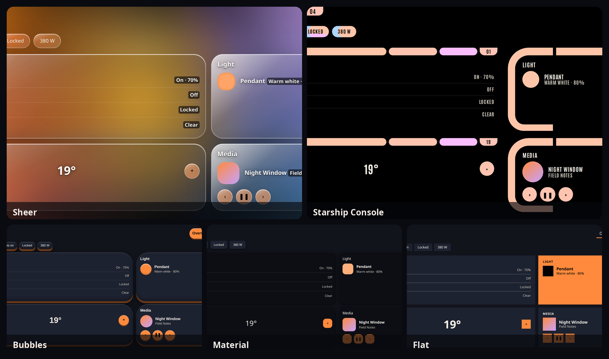

# HomeChameleon

Turn your photos into complete Home Assistant themes, in the style you pick.



HomeChameleon is not affiliated with or endorsed by the Open Home Foundation or Home Assistant, and is not affiliated with ha-chameleon. ha-chameleon colors RGB lights. HomeChameleon builds dashboard themes.

## What works today

The editor in [`web/`](web/) runs in the browser. Drop up to eight photos, or import an Omarchy `colors.toml`, a Base16 scheme, a hex list, or `homechameleon-palette/1` JSON (a `?palette=` link works too). Pick Sheer, Bubbles, Material, or Starship Console, then Dark, Light, or Auto. A sample dashboard follows the CSS variables from the generated theme. Undo, redo, and blueprints stay in this browser.

Export writes a zip with `themes/<slug>.yaml` and an install readme. A wallpaper is included under `www/homechameleon/<slug>/` only when the background toggle is on. It is off by default. An optional card-mod snippet is included only when that extra is on.

In the standalone editor, photos stay in the browser. It does not upload them and it does not ask you to sign in. The Home Assistant API receives an image only when a client posts one.

[`homechameleon-core`](crates/homechameleon-core) is the generator the editor runs as WebAssembly.

- Extraction uses OKLab k-means for the neutral and Material Color Utilities (quantize and score) for the accent. Modes: normal, pastel, material, colorful, muted. A mood board is a weighted merge of up to eight images.
- Palettes: Omarchy `colors.toml`, base16, a role map, a hex list, and `homechameleon-palette/1` JSON.
- Light and dark roles. WCAG AA or AAA contrast is part of choosing each tone. Sheer also checks text on the card composited over the wallpaper (or over the solid background when the wallpaper is off).
- Styles: Sheer, Bubbles, Material, and Starship Console. Bubble Card and Mushroom variables are included. card-mod CSS is off unless you ask for it.
- The same input produces the same bytes on native and on wasm.

The [`omarchy/`](omarchy/) folder is a shell helper for Omarchy. `homechameleon-sync --export` writes `homechameleon-palette/1` JSON from a `colors.toml` file. Details are in [omarchy/README.md](omarchy/README.md).

## Install on Home Assistant

HomeChameleon also installs as a custom integration through HACS. It adds a sidebar panel named HomeChameleon and an admin-only API. The panel is the same editor. Apply writes the theme the browser already built. The default-theme checkbox starts off. Apply can target one dashboard view, and Undo theme restores the previous themes. The downloadable zip still works if you open the editor on its own.

1. In HACS, add this repository as a custom repository (category: Integration): `https://github.com/homechameleon/homechameleon`
2. Install HomeChameleon and restart Home Assistant.
3. Add these lines to `configuration.yaml` once, if they are not already there, then restart again:

```yaml
frontend:
  themes: !include_dir_merge_named themes
```

HomeChameleon does not edit `configuration.yaml`. If those lines are missing, it raises a Repairs issue that shows the same lines.

4. Go to Settings, then Devices & services, and add HomeChameleon. Open the HomeChameleon sidebar item. That page is limited to administrators.

`POST /api/homechameleon/generate` accepts the same JSON the Omarchy helper sends, or multipart form data. It runs the same `homechameleon-core` WebAssembly module under Wasmtime, after Pillow decodes the images. Pillow is the copy Home Assistant already installs, so the manifest does not list it. Wasmtime is the extra requirement. `POST /api/homechameleon/preview` returns the theme and writes nothing.

`POST /api/homechameleon/apply` can name one dashboard view (`view.url_path` plus `view.path` or `view.index`). That request records the global theme, each user's theme, and the view's theme, stores a snapshot of the dashboard, then sets the view. `set_default` stays off unless the request sets it. `POST /api/homechameleon/undo` puts the recorded themes back in one step.

Snapshots live in `www/homechameleon/snapshots/`. Administrators can list them, read one, restore a storage dashboard, and delete them at `/api/homechameleon/snapshots`. A YAML dashboard can be copied, and restoring it is refused, because HomeChameleon does not edit that file. Snapshot files are served from `/local/` the same way a wallpaper is.

`POST /api/homechameleon/room` takes an area id or an area name and returns a Lovelace view for that area. It reads the area and its entities when the request arrives. The view uses core cards unless Mushroom or Bubble Card is installed, and then only for ordinary entities. Locks, garage covers, and alarm panels ask for confirmation. Cameras are view only. The response is the view, as JSON and YAML. It does not write a dashboard. `GET /api/homechameleon/areas` lists areas for the panel. Both routes are limited to administrators.

In the Home Assistant panel, the Room tab previews that view with the theme you are editing, in light and dark, before anything is applied.

Home Assistant accepts an HTTP request body of up to 16 MB. A generate request larger than that is rejected by Home Assistant before this integration can answer. Once the body is read, any image over 10 MB is rejected with HTTP 413.

A background is off unless you turn it on. When it is on, the theme points at `/local/homechameleon/…`. Home Assistant serves files under `/local/` without a login, so anyone who can reach the instance and guess the file name can download that wallpaper. The first time `config/www` is created, restart Home Assistant once so `/local/` is served.

```bash
cargo test
cd web && npm ci && npm run build:wasm && npm run dev
```

The crate is not published. Theme YAML is emitted by this crate; it does not use `serde_yaml` or `serde_yml`.

## License

Released under the [MIT License](LICENSE). Copyright (c) 2026 HomeChameleon contributors.

The Starship Console sample uses [Antonio](web/public/fonts/Antonio-Bold.woff2), licensed under the SIL Open Font License. The license is in [web/public/fonts/OFL.txt](web/public/fonts/OFL.txt).
