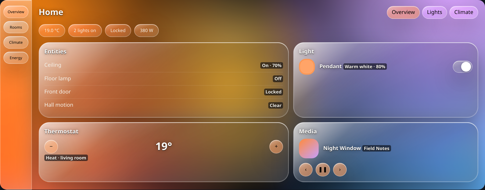
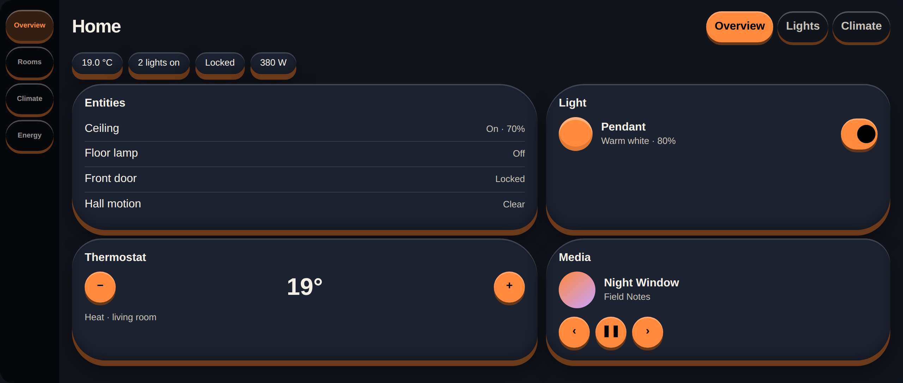
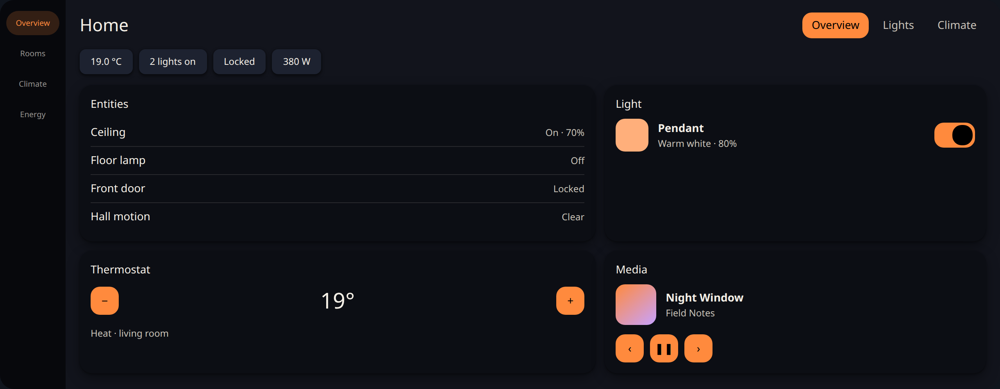
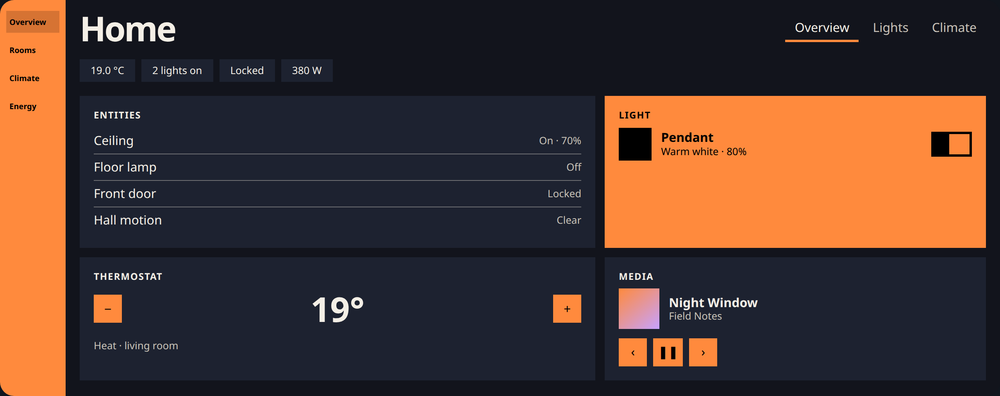
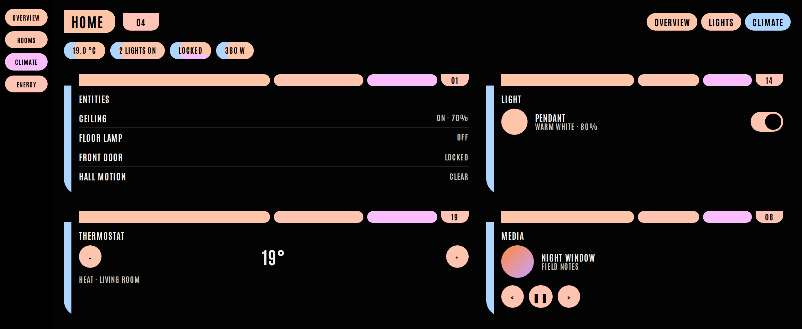

# HomeChameleon

Turn your photos into complete Home Assistant themes. This add-on is the install path when HACS is not in use.


HomeChameleon is not affiliated with or endorsed by the Open Home Foundation or Home Assistant.

## Styles

One sample palette, in dark mode.

### Sheer

Frosted panes over colorful orbs, with a light rim and a soft shadow.



### Bubbles

Blob cards, a puffy cushion, and chunky round controls.



### Material

Tonal surfaces, elevation, and a 12 to 28 pixel shape scale.



### Flat

No shadows. Square controls, large type, and solid color blocks.



### Starship Console

A sweep-elbow console: thick capped bars, numeric labels, and condensed uppercase type.



## What gets written

The add-on writes theme files to `/config/themes` and, only when a background is on, wallpapers to `/config/www/homechameleon`. It does not edit `configuration.yaml`.

Add these lines to `configuration.yaml` once, if they are not already there, then restart Home Assistant:

```yaml
frontend:
  themes: !include_dir_merge_named themes
```

`!include_dir_merge_named themes` is what makes Home Assistant load every file in the `themes` folder. The add-on shows this again when the lines are missing. It still will not change the file for you.

## Sign-in

The add-on talks to Home Assistant with the token the Supervisor provides (`homeassistant_api`). It does not ask for a user access token, and the configuration page has no token field.

The editor is the ingress panel. The add-on does not open a port on your network. Open the sidebar entry after you start the add-on. That page is limited to administrators. Apply saves the theme the editor already built, then asks Home Assistant to reload themes. You can also set that theme as the default for light and dark mode.

A background is off unless you turn it on. When it is on, the theme points at `/local/homechameleon/…`. Home Assistant serves files under `/local/` without a login, so anyone who can reach the instance and guess the file name can download that wallpaper. The first time `/config/www` is created, restart Home Assistant once so `/local/` is served.

## Install

1. In Settings, then Apps, open the repositories menu and add `https://github.com/homechameleon/homechameleon`.
2. Install HomeChameleon and start it. The first start builds the add-on on the device.
3. Add the themes include above if it is not there yet, and restart Home Assistant once.
4. Open HomeChameleon in the sidebar.

The editor is the same one as the standalone page. Photos you drop in it stay in the browser. Apply sends the finished theme file, not a separate copy of the generator.

## Remove a theme

Deleting a theme removes `themes/<slug>.yaml` and `www/homechameleon/<slug>/` only. Nothing else in the config folder is removed.
